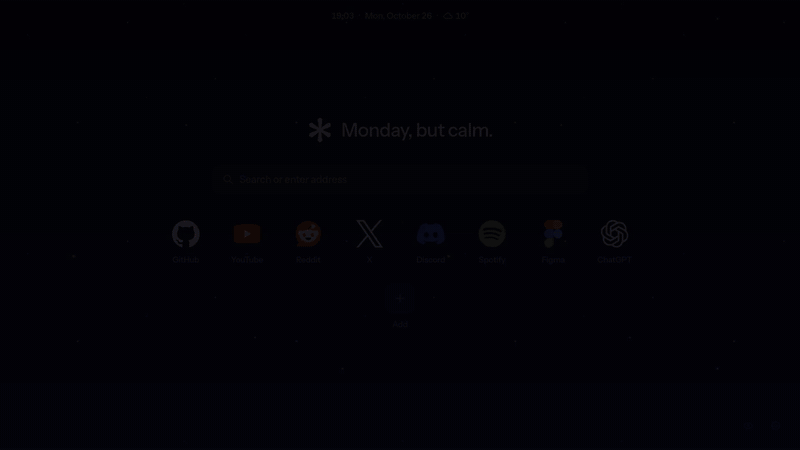
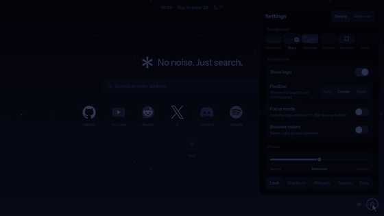
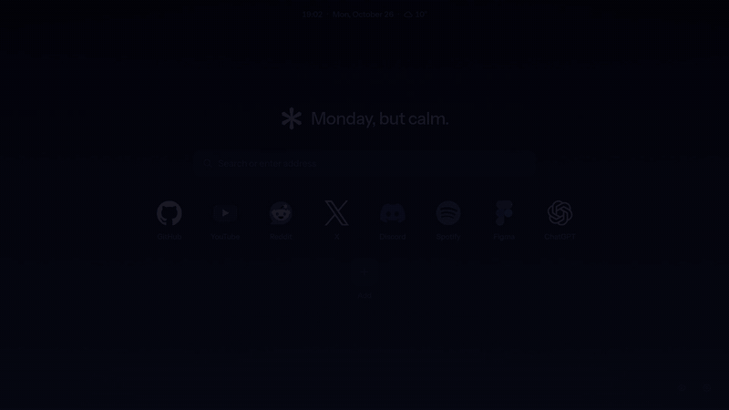
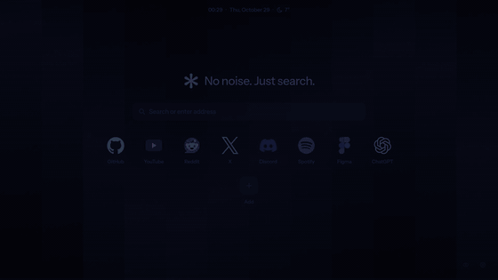
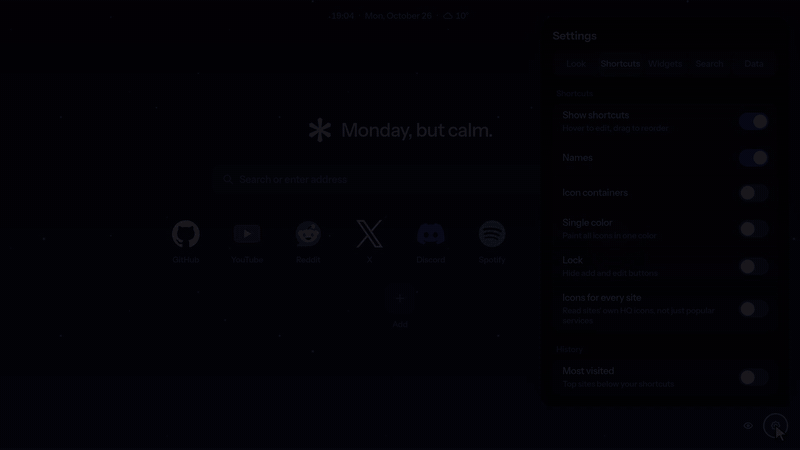
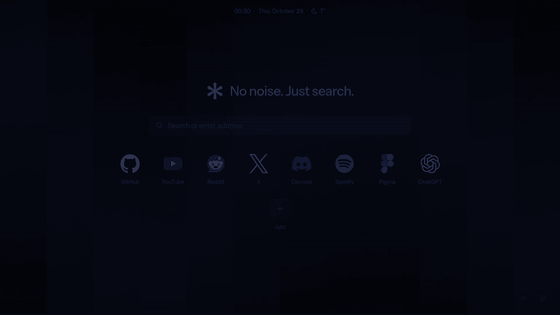
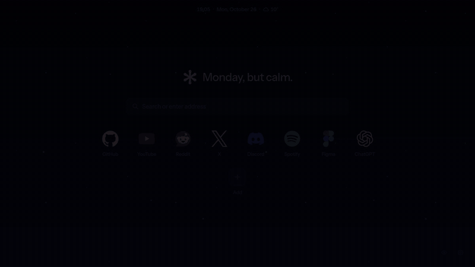
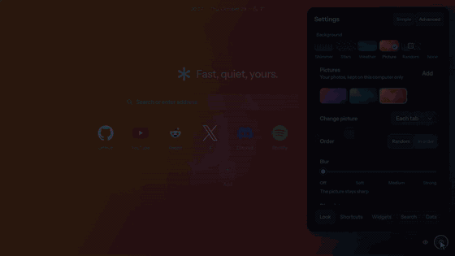
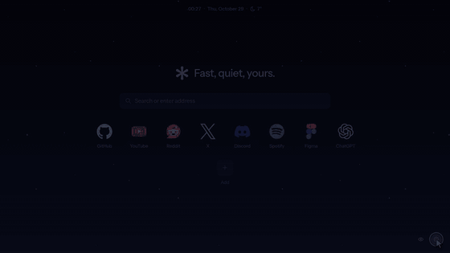
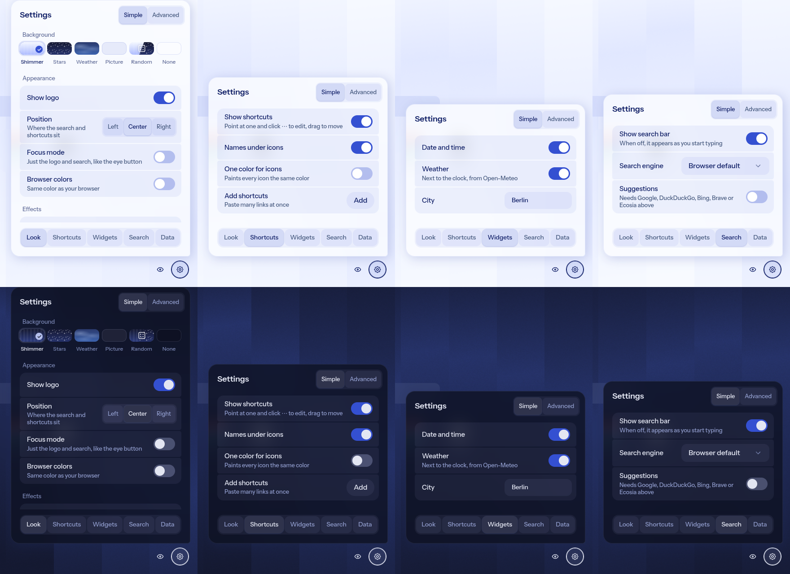

<div align="center">


# Shimmer Tab

A new tab page for the [Helium](https://helium.computer) browser, built with Helium's own UI kit, [Prism](https://github.com/imputnet/helium-prism).

[](https://chromewebstore.google.com/detail/acgnlhjcipkagocfggidelbghodlddmm)
[](https://github.com/dmitthedazed/shimmer-tab/releases/latest)
[](LICENSE)

<a href="https://chromewebstore.google.com/detail/acgnlhjcipkagocfggidelbghodlddmm"></a>

or **[try it in the browser](https://dmitthedazed.github.io/shimmer-tab/)**



</div>

## Features

- **Wallpapers.** Prism's animated shimmer, a starfield with cursor parallax, a live sky that follows your city's weather and time of day, or your own pictures and GIFs: change them each tab, hourly, daily or never, with a soft fade between them. Blur and dim the picture, or let the page take its colors from it.
- **Search with bangs.** `!yt lofi`, `cats !w`, with autocomplete from Helium's own catalog. Start typing anywhere on the page.
- **Shortcuts with sharp icons.** Vector logos for about 600 services, the site's own app icon for the rest, all optically the same size. Containers, one-colour tint, names on or off, drag to reorder.
- **Widgets.** Most visited, recently closed, date and time, weather, and quick answers for math and unit conversions in the search bar.
- **Greetings** for the time of day and a few holidays, from your local clock only.
- **Focus mode** with just the logo and search.
- **Layout** centered or along either edge.
- **Browser colors** from Helium's theme, expanded into a full Material palette.
- **Effects slider.** Speed, Balanced or Beauty. If a slow device struggles, Shimmer Tab switches to Speed on its own and tells you.
- **Simple and Advanced settings.** The basics up front, the rest one tap away.
- **Undo** for removed pictures, shortcuts and folders, and for a reset.
- Light and dark settings in Prism style, with export and import.

No account, no analytics, no server of its own. See the [privacy policy](PRIVACY.md).

<table>
  <tr>
    <td width="50%"><b>Wallpapers that flow into each other</b><br></td>
    <td width="50%"><b>A live sky for the weather</b><br></td>
  </tr>
  <tr>
    <td><b>Bangs with autocomplete</b><br></td>
    <td><b>Tiles, one color, names</b><br></td>
  </tr>
  <tr>
    <td><b>Left, center or right</b><br></td>
    <td><b>Focus mode</b><br></td>
  </tr>
  <tr>
    <td><b>Your pictures, your colors</b><br></td>
    <td><b>Speed, Balanced or Beauty</b><br></td>
  </tr>
</table>

<p align="center">
  
</p>

## Install

Get it from the [Chrome Web Store](https://chromewebstore.google.com/detail/acgnlhjcipkagocfggidelbghodlddmm).

Or without an extension: set <https://dmitthedazed.github.io/shimmer-tab/> as your home or new tab page. Settings stay in that browser. Browser colors, most visited and sites' own icons need the extension.

> [!NOTE]
> For **Browser colors**, also turn on **Allow access to file URLs** in the extension's details. Chromium doesn't give extensions the theme, so Shimmer Tab reads it from the policy files in `/etc/chromium/policies/`.

<details>
<summary>Build from source</summary>

```sh
cd helium-newtab
pnpm install
pnpm build
```

Open `helium://extensions`, turn on **Developer mode**, click **Load unpacked** and pick `helium-newtab/dist`.

Other scripts:

| Command | |
| --- | --- |
| `pnpm icons:refresh` | Update the vector logo list from svgl |
| `pnpm bangs:refresh` | Update the bundled bang catalog |
| `pnpm pages` | Build the web version into `gh-pages` (`--push` to publish) |
| `scripts/record-clips.sh` | Record the preview clips with a headless Helium (needs ffmpeg and a GPU) |
| `scripts/clips-to-gifs.sh` | Turn the clips into the README GIFs |
| `scripts/settings-shots.sh` | Retake the settings picture |

Publishing a GitHub release attaches the extension zip and refreshes the web version.

</details>

<details>
<summary>How icons work</summary>

Best first:

1. Vector logos from [svgl](https://svgl.app) with light and dark variants.
2. The site's own high-res icons: web app manifest, apple-touch-icon, SVG favicon or a sized `<link rel="icon">`.
3. A colored letter.

Each icon is measured on a canvas and scaled by area, so round, square and wide logos look the same size. Reading other sites' icons needs the optional access to all websites.

</details>

## Translations

Every string is in [`helium-newtab/src/locales/en.json`](helium-newtab/src/locales/en.json), translated on [Crowdin](https://crowdin.com). The page follows the browser's language.

## Credits

- [Helium Prism](https://github.com/imputnet/helium-prism) (GPL-3.0) for the UI components
- Starfield after [ErrorZeros' Helium New Tab](https://github.com/ErrorZeros/Helium-New-Tab-by-ErrorZeros)
- Bang resolver from [exsesx/helium-new-tab](https://github.com/exsesx/helium-new-tab) (MIT)
- Bang catalog by Kagi Search and imput (MIT)
- Logos via [svgl](https://svgl.app), trademarks of their owners
- Weather by [Open-Meteo](https://open-meteo.com), sky rendered with [Atmosphere](https://github.com/takustaqu/atmosphere) (MIT)

License texts for the MIT parts are in [`licenses/`](licenses).

Not affiliated with imput or the Helium project.

## License

GPL-3.0, since the extension bundles Helium Prism.
